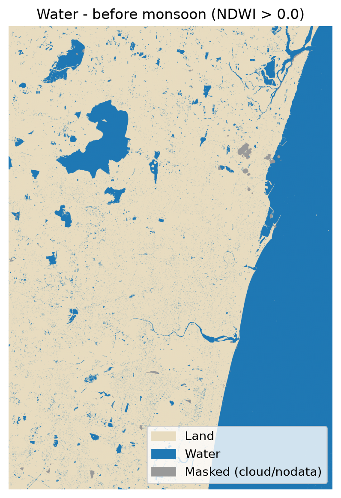
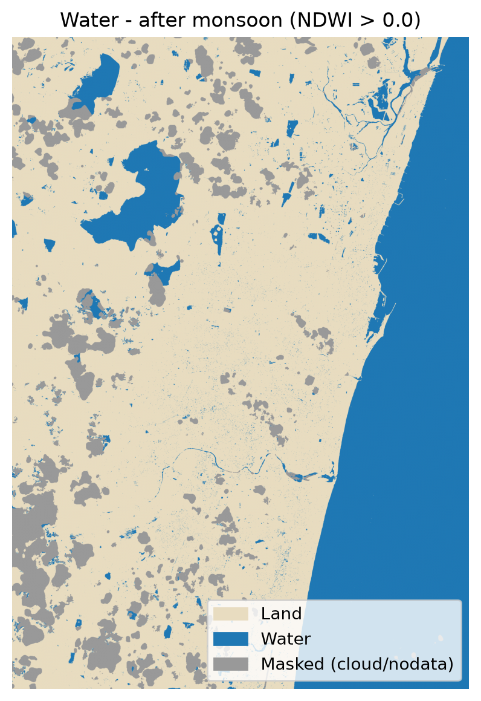
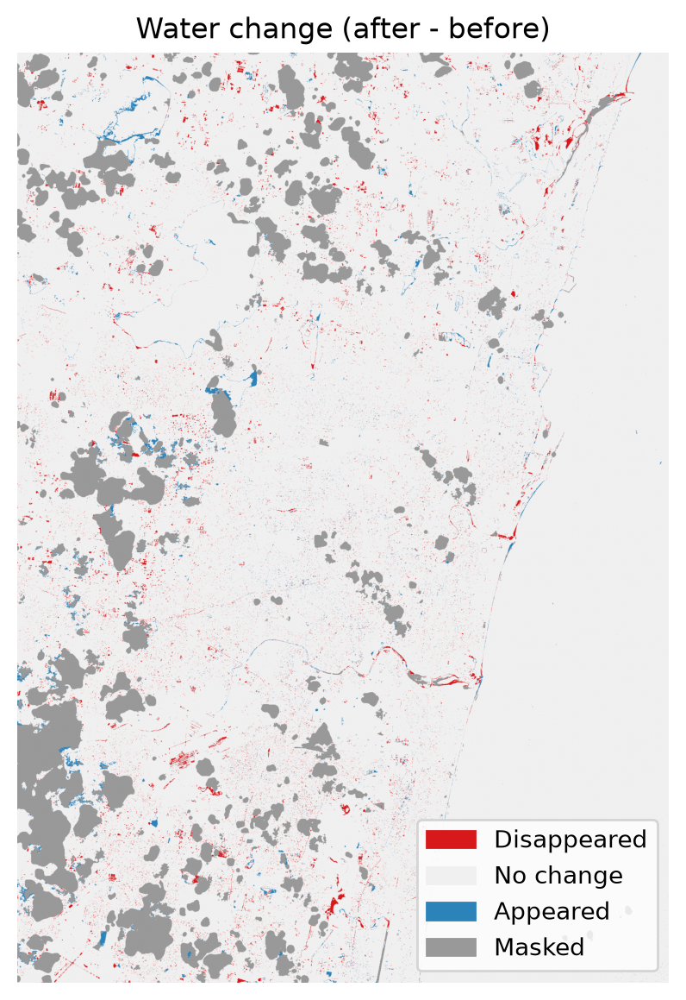

# Chennai Water Change Detection

Mapping how surface water in Chennai changed across the **2025 north-east monsoon**, using Sentinel-2 imagery, cloud masking and the NDWI water index.


Two cloud-masked Sentinel-2 scenes (6 Oct 2025 and 14 Jan 2026) are compared pixel by pixel. The project produces a water map for each date, a change map, water areas in km², a change-map GeoTIFF, and a small web API that does the same for any pair of dates.

**Contents:** [Results](#results) · [Data](#data) · [Quick start](#quick-start) · [API](#api-bonus) · [Method](#method) · [Outputs](#outputs) · [Limitations](#limitations) · [Project structure](#project-structure)

---

## Results

| Date | Total water (incl. sea) | Inland water |
|---|---|---|
| Before: 2025-10-06 | 299.31 km² | **55.05 km²** |
| After: 2026-01-14 | 292.92 km² | **48.55 km²** |

Inland water **appeared** on 7.43 km² and **disappeared** on 13.93 km², a net change of **-6.50 km² (-11.8%)**. All areas are computed on the 955.67 km² that was cloud-free on both dates. The Bay of Bengal (244.44 km²) is reported separately.

<table>
  <tr>
    <td align="center"><br><sub>Water before (6 Oct 2025)</sub></td>
    <td align="center"><br><sub>Water after (14 Jan 2026)</sub></td>
    <td align="center"><br><sub>Change (after - before)</sub></td>
  </tr>
</table>

**Sensitivity to the water threshold**

| | NDWI > 0 | NDWI > 0.1 |
|---|---|---|
| Inland water before / after | 55.05 / 48.55 km² | 41.15 / 37.98 km² |
| Appeared / disappeared | 7.43 / 13.93 km² | 2.96 / 6.13 km² |
| Net inland change | -6.50 km² (-11.8%) | -3.17 km² (-7.7%) |

The direction of the change is the same at both thresholds, but its size is not, so it is best read as a range of roughly 3 to 6.5 km². The early-October scene may still hold water from the preceding season, so this result should not be read as monsoon-driven drying. See [Limitations](#limitations).

---

## Data

Both scenes are Sentinel-2 **Level-2A** products from the [Copernicus Browser](https://browser.dataspace.copernicus.eu/), taken from the **same tile and relative orbit** so that pixels line up without any reprojection.

| | Before | After |
|---|---|---|
| Product | `S2C_MSIL2A_20251006T045711_N0511_R119_T44PMV_20251006T093213` | `S2C_MSIL2A_20260114T050151_N0511_R119_T44PMV_20260114T080009` |
| Date | 2025-10-06 | 2026-01-14 |
| Tile / orbit | T44PMV / R119 | T44PMV / R119 |
| Cloud cover (whole tile) | 7.46% | 2.07% |

The raw scenes are about 1 GB each and are **not** stored in this repository. Download both, unzip them, and place them like this:

```text
data/
├── before/S2C_MSIL2A_20251006T045711_N0511_R119_T44PMV_20251006T093213.SAFE
└── after/S2C_MSIL2A_20260114T050151_N0511_R119_T44PMV_20260114T080009.SAFE
```

---

## Quick start

```bash
git clone https://github.com/AkashM1103/Earth-Observation-Data-Processing.git
cd Earth-Observation-Data-Processing

python -m venv venv
# Windows PowerShell:  .\venv\Scripts\Activate.ps1
# macOS / Linux:       source venv/bin/activate

pip install -r requirements.txt
```

Run the analysis:

```bash
python water_change.py \
  data/before/S2C_MSIL2A_20251006T045711_N0511_R119_T44PMV_20251006T093213.SAFE \
  data/after/S2C_MSIL2A_20260114T050151_N0511_R119_T44PMV_20260114T080009.SAFE \
  --out outputs
```

On Windows PowerShell, put the command on one line instead of using `\`.

| Option | Default | Meaning |
|---|---|---|
| `--out` | `outputs` | Folder for the results |
| `--threshold` | `0.0` | NDWI value above which a pixel counts as water |

Try `--threshold 0.1` with `--out outputs_t01` to reproduce the sensitivity test. A run takes about 10 to 60 seconds.

---

## API (bonus)

A [FastAPI](https://fastapi.tiangolo.com/) service wraps the same processing. It finds the scenes in `data/` by **acquisition date**, so you pass dates, not file paths.

```bash
uvicorn api:app --reload
```

Then open **http://127.0.0.1:8000/docs** for the interactive page.

| Endpoint | Description |
|---|---|
| `GET /scenes` | Lists the dates and tiles found under `data/` |
| `GET /analyze?before=2025-10-06&after=2026-01-14` | Runs the analysis and returns areas in km² plus links to the outputs |
| `GET /files/{run_id}/{filename}` | Downloads a map (PNG), the GeoTIFF or `results.json` |

`/analyze` also accepts `threshold` (default `0`) and `tile` (default `T44PMV`). Results are cached in `api_outputs/`, so a repeated request returns immediately. A date with no scene returns a 404 that lists the available dates, and `before` must be earlier than `after`.

Example response (abridged):

```json
{
  "before": "2025-10-06",
  "after": "2026-01-14",
  "tile": "T44PMV",
  "cached": false,
  "results": {
    "inland_water_before_km2": 55.05,
    "inland_water_after_km2": 48.55,
    "inland_appeared_km2": 7.43,
    "inland_disappeared_km2": 13.93
  }
}
```

The API analyses scenes that are already downloaded. It does not fetch data from Copernicus.

---

## Method

1. **Crop.** Bands B03 (green) and B08 (NIR), both 10 m, are read for a Chennai bounding box (80.10 to 80.35 °E, 12.90 to 13.25 °N).
2. **Cloud mask.** The 20 m scene classification layer (SCL) is resampled to 10 m with nearest-neighbour, which keeps the class codes intact. Classes 0, 1, 3, 8, 9 and 10 are masked: no data, saturated, cloud shadow, medium and high cloud probability, and thin cirrus.
3. **NDWI.** The +1000 reflectance offset of processing baseline N05.11 is removed and values are divided by 10000. Then `NDWI = (Green - NIR) / (Green + NIR)`, and a pixel is water where NDWI is above the threshold.
4. **Change detection.** Each pixel is classed as appeared (`1`), disappeared (`-1`), unchanged (`0`), or no data (`127`) when masked on either date.
5. **Areas.** Only pixels that are clear on both dates are counted, at 100 m² per pixel, so the totals agree with the change map. The sea is the wide water body touching the eastern edge of the crop, found with a morphological opening (31 px). All remaining water is inland.

---

## Outputs

Written to the folder given by `--out`:

| File | Description |
|---|---|
| `water_before.png` | Water map, before the monsoon |
| `water_after.png` | Water map, after the monsoon |
| `water_change.png` | Change map (appeared, disappeared, no change, masked) |
| `water_change.tif` | Change-map GeoTIFF: `int8`, EPSG:32644 (UTM 44N), 10 m, nodata 127 |
| `results.json` | Areas in km², masked percentages and the threshold used |

Open `water_change.tif` in QGIS over an OpenStreetMap basemap to inspect it.

---

## Limitations

- **Cloud masking in the January scene.** 9.2% of the crop is masked, including patches over reservoirs in the west and south-west, so change there cannot be assessed. The before scene is only 0.3% masked.
- **Threshold sensitivity.** About a quarter of inland water has NDWI between 0 and 0.1 (wet soil, flooded fields, shallow or turbid water), and the change map has fine speckle from pixels near the cut-off. Urban shadows can also read as water.
- **Dynamic water edges.** River mouths and backwaters change with tide and sandbars, so some change there is not rainfall-driven.
- **Method limits.** A bounding box is used instead of the exact city boundary, the SCL is 20 m while NDWI is 10 m, and only two dates are compared, so the cause of the change cannot be determined.

Ideas for improvement: more dates, a city-boundary mask, MNDWI using the SWIR band, and a minimum patch size to remove speckle.

---

## Project structure

```text
.
├── water_change.py                    # Processing pipeline and command-line tool
├── api.py                             # FastAPI service
├── requirements.txt
├── Chennai_Water_Change_Summary.pdf   # Written summary: approach, results, problems
├── outputs/                           # Maps, GeoTIFF and results.json
├── data/                              # Sentinel-2 scenes (not in the repo)
└── api_outputs/                       # API result cache (not in the repo)
```

## Acknowledgements

Contains modified Copernicus Sentinel data (2025 to 2026), processed by ESA and accessed through the Copernicus Data Space Ecosystem.
